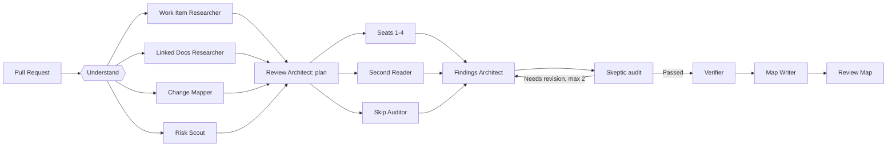

# Changeset Risk Map preset (a reading plan for a pull request too large or too risky to read line by line)

Context: direct session, director-requested. Branch: main. Status: current. Repo: agentic-workflow-designer.

```awd:record
{"slug": "changeset-risk-map", "status": "current", "date": "2026-11-16", "files": ["index.html", "tests.html", "README.md", "TECHNICAL.md"], "verify": ["./run-tests.sh"], "superseded_by": null}
```

## Current behavior

A 24th preset, Changeset Risk Map, sits after Review Swarm under More presets. Its product is a one-page review map for the person who must approve a large or high-risk pull request: the few files that need their own eyes and why, comments worth posting, what was proven by running (or that nothing was run, and why), what the agents read and found sound, what is mechanical (with the check that proves it), and what nobody checked. It reads the work items and linked documents first, so it can report required behavior that is missing and behavior nobody asked for. An entry reaches the director only as a concrete failure, a gap against the work items, or a hard-to-reverse decision that could lock the team into a poor direction; style and taste never qualify, and no entries is a normal result. The run delivers a report: it changes no code and posts nothing. The full map, suggested comments included, is saved uncommitted as `review-map-<workflow name>.md` at the root of each working directory the run worked in (a second copy in the run's memory folder where workflow memory is on), and the final message says what the file adds when it shortens anything. The tooltip says it is the slowest and most expensive review preset and names Code Review and Review Swarm for an ordinary change.

## How it works



One builder in `loadPreset` (`changeset_risk_map`) assembles existing node types only. The Change Mapper sorts every changed file and must prove a mechanical group with a check anyone can rerun; the Skip Auditor reruns it and hunts for the file that does not belong. The Review Architect divides the logic among four fixed seats (a canvas is fixed, so the plan assigns areas to seats; an empty seat finishes in one line) and names the highest-risk assignment for a blind Second Reader. The Findings Architect merges, adds what only the whole view shows (including who consumes a changed contract, through whatever code search the run has), applies the bar, marks what is worth a run, and accounts for every file. The existing Skeptic, with its existing audit-the-findings lens, adjudicates each entry by reading. Only then does the Verifier run code, and only for marked entries a run can settle; running nothing is a sound result. The Map Writer states an entry a run confirmed as fact and leaves out one a run refuted. The surprise: the reviewer seats are `researcher` nodes, not `reviewer` nodes, because the reviewer role carries the comment-nit hint and this preset's bar excludes nits.

## Why and scope

AI made writing code fast and left review as the place work waits. Code Review fixes code and Review Swarm lists findings; neither tells a person where to look and what they can skip, and neither reads the work items as a research step. Scope: one builder, one tile with tooltip, one requirements template, twelve prompt templates sharing three constants, one sentence added to two neighbor tooltips, (`RISKMAP_BAR`, `RISKMAP_MATERIAL`, `RISKMAP_REVIEW_STEPS`), `riskMapSeatPrompt`, tests, docs. Non-goals: no new setting, gate, node type, or shared hint; no comment posting; no script step; no run-time fan-out; no score or grade; the other 23 presets are byte-identical.

## Approach and decisions

- A new preset, not a tune of the two review presets: its one job is a reading plan (director: it "needs to pull its weight somehow if we create it").
- No script step and no comment posting; read-only the way the other read-only presets are (director).
- Three coverage groups plus Not checked, not two: files the agents read and found sound are a model opinion and must not be called proven.
- Architecture entries are allowed only with the existing pattern named in the codebase, raised as a question (director: flag a change that goes against the rest of the codebase, with strict discipline about what is raised).
- One architect seat used twice (plan, then consolidate) and no second review round; the Skeptic stays separate so the audit is independent.
- Cross-repository search is used when the run has one and the entry stays a question when it has none (director: must work with any code search and with none).
- Named Changeset Risk Map, not Pathfinder Review: the first name was close to a well-known skill and said neither who it is for nor what it produces (director). Changeset is host-neutral and suggests size, Risk says when to reach for it, Map says the output directs attention and approves nothing. Code Review and Review Swarm each gained one tooltip sentence pointing here.
- The Verifier runs last and by judgment (director: do not force practical testing; let the agents decide when it is worth it, and let it consider the reviewers' findings). Reading comes first because it is cheap; the Verifier gets a short, consolidated, audited list, reads existing pipeline results before running anything, and may run nothing. It keeps the `verifier` role for the verification-instructions and browser hints; that role also carries the shared found-defect note, so its prompt states that a defect here is reported and never fixed.
- The Durable Record switch applies as it does to every preset (director: that is how the designer works when the option is on).
- The map has a stated home (director, after the first real run): that run saved the map only in the memory folder, by the agent's own choice, and its final message left the comments out. The map now goes to the root of each working directory under the workflow name, beside the record's folder and never inside it (the record protocol allows exactly three kinds of file there), with the memory copy kept.

## Verify

- `./run-tests.sh`: 2195 -> 2213 (18 new tests: shape, parallel stages, seats, the bar, no nit hint, the Skeptic loop, mechanical proof, the map sections, material-not-instructions, cross-repository fallback, no product names, report-only roles, five formats, the tile, the Verifier's place and judgment, the neighbor tooltips, where the map is saved).
- Full-output diff against the previous commit (23 presets, 8 variants, 5 formats, 920 outputs): zero differences. Golden maps gained 21 values, all for the new preset key.
- Agent facade: 24 presets x 5 formats generate cleanly; each of the 15 agents' prompts lands in that agent's own step in all five formats.
- One real run (2026-11-16, an earlier build) produced a map with nine comments and a Not checked list; it exposed the missing map location. Not yet measured: on a merged pull request with a known later defect, does the map point at the defect files, and how much reading does it remove.

## History

- 2026-11-16: created (by direct session).
